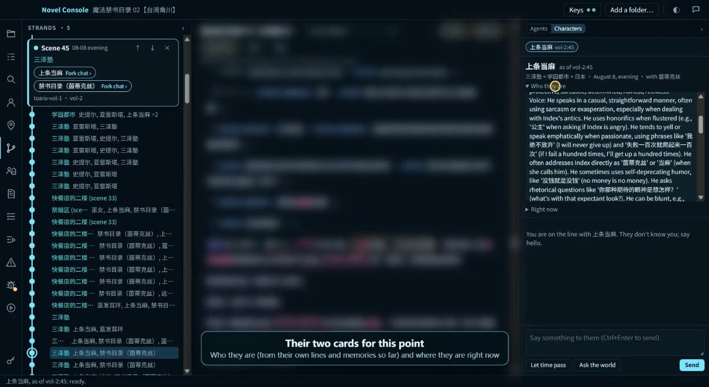
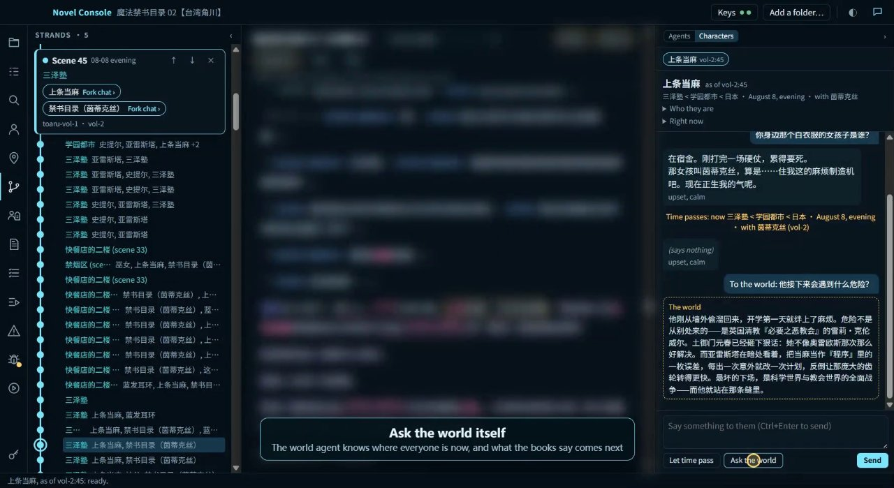
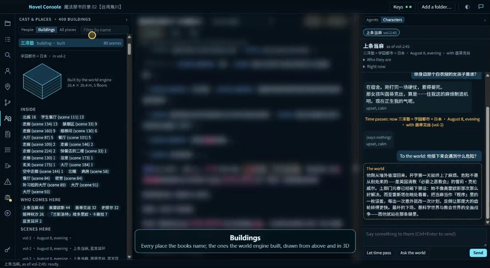

# story-graph

A knowledge system that teaches an agent to act as a character from a novel series: for people who build character
chatbots on Discord, QQ or the web.

Give it the books of a series. It reads them into a story graph (who is in each scene, who says each line, where and
when it happens), finds the same person across every volume, and gives every character their own memories of what they
lived through, with how it felt. From those it writes the character's cards (who they are; where they are now) and runs
a small mind that answers as them, remembering only what they could know at that point of the story.

Nothing here is about one book: every method works for any series, and no word lists are kept.

## Demo

[](docs/demo/story-graph-demo.mp4)

**[Watch the demo (1:37)](docs/demo/story-graph-demo.mp4)**: six volumes of one series read as one world, shown in
[Novel Console](https://github.com/gardianofthedarkness/novel-console). The model replies are live; waits on the models
are sped up. The book's own text is blurred: nothing of a book is published here.

- **Strands**: who stays together, where they part and meet again. Pick any scene; its card shows when, where and who
  is there.
- **Fork a chat** from that scene with anyone in it: they are as they were at that moment, knowing only what they have
  lived up to it. Talk to them, let time pass (they go on to their next scene in the books), or ask the world itself,
  which knows where everyone is and what comes next. A chat is its own branch; the books never change.
- **Cast & places**: everyone and every place of the world across all its books, each person once whatever each volume
  calls them; buildings the world engine built, from above and in 3D. Chat with anyone as of the end of any book.

| Talking to a character, and asking the world | The cast and the buildings |
| --- | --- |
|  |  |

The front end's calls are `engine/persona/studio.mjs` (the library, a person, a place, fork, turn, ask), so a chatbot can
use the same things without the console.

## What it makes

| Layer | What | Where |
|---|---|---|
| Reading | Scenes, sentences, who is present and who speaks, places in the text, story time (the book's own calendar), front and back matter (paratext) | `engine/reading`, `src/reading` |
| Universe cast | One id per person across all volumes (`p_0001` …), each with the book entities it unites | `engine/universe/cast.mjs`, `src/universe/identity` |
| Memories | Each character's own memories of each scene: a summary in their view, arousal and valence, cues (people, things), when they learned it in story days | `engine/memory` |
| Recall | A Cypher query over the memory graph (LadybugDB): importance from felt arousal fading with story-time age, cue match and mood | `src/ground/ontology/memory.ts` |
| Cards | The character card (who they are, how they talk, the people who matter) and the present card (where they are, what just happened), at any point of the story | `engine/persona/cards.mjs` |
| Mind | Departments in parallel (memory, emotion, subjectivity, action) and a brain stem that picks what surfaces; the action faculty looks before it speaks | `engine/persona/mind.mjs` |
| World agent | Knows every scene's place, time, people and what happens, now and later in the books; answers the user and moves the call on through the story | `engine/persona/world.mjs`, `god.mjs` |
| Channels | A terminal phone and a web console ("a phone from another universe"); Discord and QQ next | `engine/persona/phone.mjs`, `web.mjs` |

A world engine (terrain, buildings, where each person stands) can add positions: when a book's
`novel/stage/world/spawn.json` is there, the world agent shows them on a map. Without it everything above still works.

## Models

- Jev (decisions: a choice, a score, a box) for the reading's judgements, the cast, emotion and the brain stem.
- A work model (OpenAI-compatible; DeepSeek by default) for the memories' summaries, the cards and what a character says.

Keys come from the environment (`TYPESAFE_API_KEY`, `WORK_LLM_API_KEY`) or, on Windows, from the Credential Manager
(`novel-ontology/jev`, `novel-ontology/deepseek`). Every paid reply is cached, so a rerun pays only for what changed.

## Use

```bash
npm install
npm run build
```

Read a book (a workspace folder with its source), then build its universe and memories:

```bash
node engine/reading/read.mjs <novel-dir> <out-dir> --epub <book.epub>
node engine/reading/paratext.mjs <novel-dir>
node engine/universe/cast.mjs <library>
node engine/memory/memories.mjs <volume-dir>
```

Talk to a character at a point of the story (`vol-6` is the end of volume 6, `vol-6:120` its 120th scene):

```bash
node engine/persona/phone.mjs <library> --person <id or name> --at vol-6
node engine/persona/web.mjs <library> --person p_0002@vol-2,p_0008@vol-6 --at vol-6 --port 8795
```

`--mock` runs without models (no keys, no spend).

## Tests

```bash
npm test             # the TypeScript tests
npm run engine:test  # the engine scripts' tests
```

## History

Split from [novel-ontology-pi](https://github.com/gardianofthedarkness/novel-ontology-pi) on 2026-11-21 with the history of
every file it took; the world engine there (terrain, places, the director) depends on this package.

## License

MIT.
